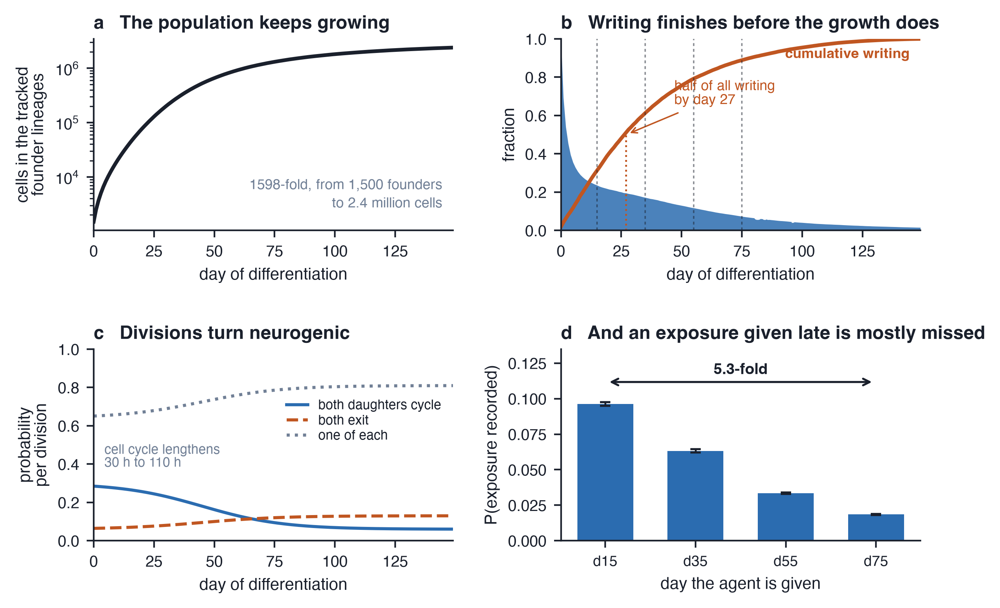
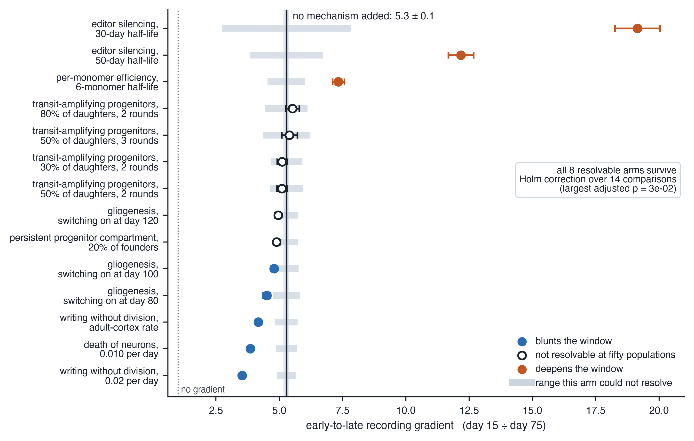
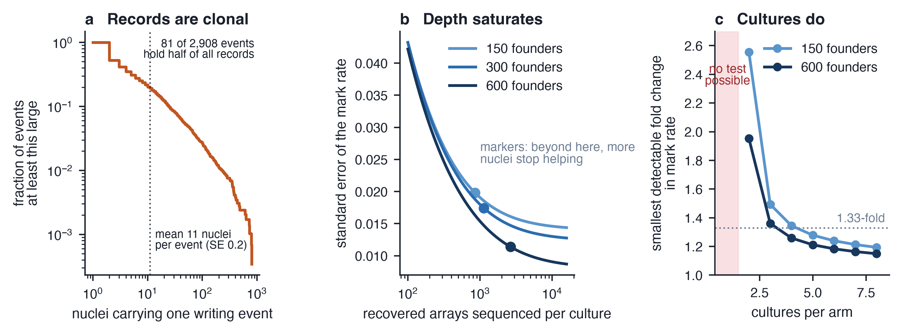
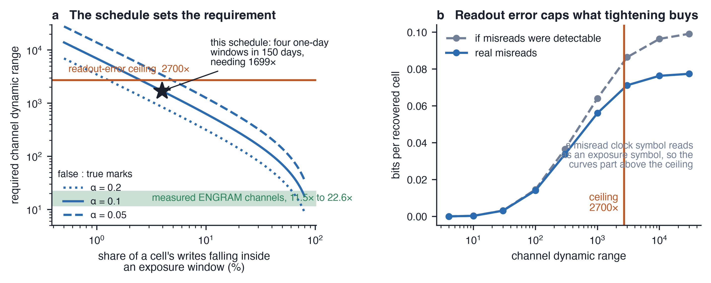
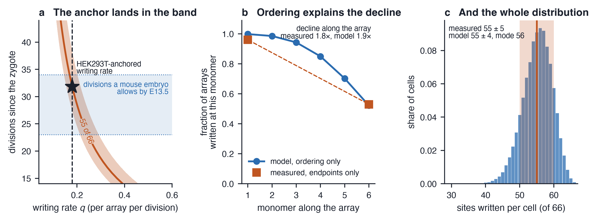

# The writable window: division-coupled DNA recorders carry a built-in early bias in human cortical organoids

**Denis Zosen**

Norwegian Centre for Molecular Biosciences and Medicine (NCMBM), University of Oslo, Norway. ORCID 0000-0003-4722-9921.

Correspondence: denis.zosen@ncmbm.uio.no

## Abstract

DNA recorders write signalling and lineage history into the genome, where sequencing can recover it later. They were built in rapidly dividing cell lines and characterised over days. Asking when a chemical perturbs human brain development instead means running a recorder for several months in a tissue that changes while it is measured: neural progenitors divide, give rise to neurons, and leave the cell cycle permanently, so the dividing population shrinks throughout. To learn what such an experiment can resolve, I modelled a branching progenitor population coupled to sequential writing into a tandem array.

Because writing happens at division, a recorder falls silent long before the experiment ends. Half of all symbols are written before day 27 of 150, and a cell is 5.3-fold more likely to record a one-day exposure given on day 15 than on day 75, a ratio that runs from 2.7 to 6.6 across plausible parameterisations of the tissue. An experiment comparing exposures at several developmental stages therefore carries a built-in gradient shaped like the window it is meant to detect, and a genuine five-fold late window comes back flat. Seven mechanisms were tested as 14 arms across 50 simulated populations. Eight arms move the gradient detectably, and none removes it; gliogenesis, the one mechanism that restores proliferation rather than redistributing it, blunts it by a tenth to a seventh depending on when the switch falls. A writer decoupled from division entirely gives a gradient of 1, so the whole of the effect is the coupling. Held at a cell-line writing rate, the recording model also reproduces, without refitting, the array occupancy measured in one published mouse embryo, which tests the writing chemistry, but not the writable window. Records are clonally correlated, so precision comes from cultures and founder lineages, not sequencing depth.

**Keywords:** molecular recording, prime editing, brain organoid, human corticogenesis, experimental design, pseudoreplication

## 1. Introduction

A molecular recorder writes into DNA and is read by sequencing, so a cell carries its own history to the end of an experiment. Cumulative Cas9 editing established combinatorial lineage barcodes [1,2]; homing guides and self-targeting arrays extended them to whole embryos [3,4]; and prime editing [5,6] made it possible to insert short, ordered, identifiable symbols, where earlier Cas9 recorders could only cut a site once and leave error-prone repair to generate a scar of no chosen meaning. DNA Typewriter writes symbols into successive monomers of a tandem array, at most one symbol per cell division and always into the next unwritten monomer, so the order of events survives to the readout [7,8]; when a cell leaves the cycle it stops writing and the remaining monomers stay empty. ENGRAM couples the identity of the inserted symbol to the activity of a cis-regulatory element, turning the array into a multi-channel signalling log [9,10].

These systems were characterised where they work best: in HEK293T cells over about 25 days of expansion, since then in mouse embryos [7,11], and for the ENGRAM channels in cell lines under strong synthetic stimuli [9,10]. Those are the right experiments for establishing that a recorder works. They are not the regime in which one would be asked to answer a developmental question, where the experiment runs for months in tissue whose dividing population is disappearing.

The questions that make recorders attractive unfold over months. Whether prenatal exposure to a medicine or a chemical injures the developing human brain is one; so is the sharper question behind it, whether susceptibility is concentrated in particular developmental windows. That second question is what this paper is about, because an experiment designed to answer it compares exposures given at different times, and the comparison is exactly what a division-coupled recorder distorts. Guided dorsal forebrain organoids are the main tractable model: an agent can be applied on a chosen schedule and the same culture sampled at the end. The 150-day endpoint used throughout is the midpoint of the 100-to-200-day range over which these protocols are usually run, and the stage by which both deep-layer and upper-layer neurons have been generated [12,13,14,15].

Two features of these cultures decide what a recorder can do in them. Progressive cell-cycle exit happens in other differentiating systems too, but its permanence here, and the clonal unevenness that accompanies it, are pronounced in neural tissue. Apical radial glia give rise to intermediate progenitors and neurons while the cycling pool shrinks [12,13,14,15], with cell-cycle length rising through corticogenesis and divisions shifting from proliferative to neurogenic [16,17]. Unlike a renewing epithelium, a cortical neuron leaves the cycle once and never returns, so the loss of writing capacity is permanent. And clonal output is strikingly uneven: whole-tissue barcoding of cerebral organoids finds lineage sizes spanning five orders of magnitude by day 40, with 80% of progeny descending from 5% of lineages [18]. The first decides when writing is possible at all; the second decides how many independent observations a sequencing run delivers.

Prime editing is not indifferent to proliferation. The mechanism does not require passage through S phase, but its limiting determinants are enriched in dividing cells: the supply of deoxynucleoside triphosphates (dNTPs) for reverse transcription, flap endonuclease 1 (FEN1) and DNA ligase 1 (LIG1) for flap processing, and the mismatch repair that resolves or reverses the intended edit [6,19]. Editing has nonetheless been achieved in post-mitotic tissue at appreciable rates: delivery by dual adeno-associated virus (AAV) vectors reached up to 42% of alleles in neonatal mouse cortex and about 14% in bulk adult cortex [20]. This paper therefore models writing in non-dividing cells as a rate, not an impossibility.

What has not been computed is what that regime permits for questions about *when* a cell was exposed, as opposed to questions about ancestry. Prior modelling asked a different one: CRISPR recorders have been simulated to ask how accurately a lineage can be reconstructed, and realistic dropout collapses that accuracy [21,22]. That literature concerns tree topology. A second line asks this paper's question of a different recorder, deriving the precision and temporal resolution attainable by a DNA-polymerase ticker tape from Fisher information, the quantity measuring how much a measurement reveals about an unknown [23,24]. Those analyses establish the approach, which is to compute what an instrument can resolve before building the experiment, but neither treats a division-coupled recorder in a tissue that stops dividing.

To learn what such a recorder can and cannot resolve, I built a generative model of those two coupled processes and computed what the resulting data can support. Every parameter is user-settable and each was varied widely; where a parameter can be anchored to a published measurement it is, and where it cannot it is swept. The results are therefore given as rankings between design choices and as thresholds rather than as point predictions.

## 2. Results

**The model in brief.** Every result below comes from one generative model. A founder population of 1,500 cycling progenitors, each carrying one recorder array of 50 monomers, is followed for 150 days. On each division a cell writes one symbol with probability *q* = 0.18, which sits between the two measurements available: about two edits per cell division across 13 arrays in HEK293T implies 0.15 per array per division [7], and the mouse of section 2.6 requires 0.179 to 0.236. The rate is swept over more than an order of magnitude. An agent is applied in four one-day windows, on days 15, 35, 55 and 75, each an *epoch*: an interval during which the agent is present and which the experiment aims to tell apart from the others. At day 150 each array is recovered with probability 0.60, anchored to the share of organoid nuclei that returned an interpretable lineage readout in published work [25], and the observable is binary, whether the recovered array carries at least one exposure symbol. Quantities are averaged over 50 independently simulated populations unless stated otherwise, a count set by convergence rather than convention: the 95% interval on the headline gradient narrows from a half-width of 0.76 at 5 populations to 0.22 at 50, which is what separates the arms in section 2.2. Table S1 lists every parameter and whether it is a specification, an anchored measurement or a swept assumption.

**What a founder is.** A founder is a cycling progenitor carrying the recorder at *t* = 0, and only its descendants are tracked. It is not a seeding density: *t* = 0 is the onset of neurogenesis, days after aggregation, so 1,500 is not a fraction of the 3,000 to 9,000 pluripotent cells a protocol seeds per well. The unlabelled majority enters nowhere, because every quantity is reported per recorder-carrying cell. The number is swept from 150 to 6,000, which stays below the roughly 24,000 barcoded lineages one cerebral organoid experiment recovered [18], and it matters through the count of independent lineages, which sets the between-culture variance of section 2.3.

Three kinds of result follow. Closed forms are algebra and check by hand. Rankings between designs follow from the structure of the model, not from particular parameter values. Point estimates inherit a writing rate anchored to a cell line and a cycling trajectory never measured as a time series, so they give the right order of magnitude, not measurements.

### 2.1 Recording capacity is used up in the first few weeks

To find out when a recorder in this tissue can write at all, I tracked the day on which every recovered symbol was written. Recording capacity is the total number of symbols an array can hold; the question is when it gets used.

The population itself grows throughout. The tracked founder lineages expand 1,598-fold under the trajectory drawn here and 1,624-fold averaged over the populations behind section 2.2, from 1,500 cells to 2.4 million (figure 1a). Recording capacity does not keep pace.

It is used early. Half of all symbols are written before day 27 (26.8 ± 0.1 over 50 populations), 82% within the first 60 days, and fewer than 5% after day 100 (figure 1b). A cell is *writable* while it is still dividing, and the writable window is the stretch of the culture over which enough cells are still dividing for anything to be recorded. That window closes early, and figures 1b and 1c show why: divisions shift from proliferative to neurogenic while the cell cycle lengthens, so the cycling pool falls from 100% of the tracked population at day 0 to 20% by day 27 and 1.5% by day 149.

The consequence for an exposure experiment is direct. With the four one-day epochs, the probability that a terminal cell records the exposure falls from 0.096 to 0.063 to 0.034 to 0.019, a 5.3-fold decline across 60 days (figure 1d). That ratio, the early-to-late recording gradient, is formed within each population and then averaged, so it is a mean of ratios rather than the ratio of the four means above, which is why dividing those gives 5.2 and not 5.28; 50 realisations put its standard error at 0.11. The null is clean: where every division keeps both daughters cycling and the cycle never lengthens, so nothing ever leaves it, the gradient is 1.00 ± 0.02. Clonal amplification alone does not front-load, because every terminal lineage then passes through the same number of divisions in any window, so the whole of the 5.28 comes from progressive cycle exit. That null is not matched to the reference on anything else and cannot be: never leaving the cycle means it divides far more, filling 22 monomers per array against 6. It isolates the coupling rather than providing a like-for-like control. Across seven alternative parameterisations, spanning cell-cycle lengths of 22 to 140 hours and fate-switch midpoints from day 30 to day 65, the gradient runs from 2.7 to 6.6 and the half-capacity day from 24 to 33. That range is wider than the effect of all but three of the 14 arms in section 2.2, so a number quoted for one protocol should not be carried to another.

**Figure 1. The population keeps growing long after it has stopped being writable.** (**a**) Cells in the tracked founder lineages over time, on a logarithmic axis. These are the lineages carrying the recorder, not the whole organoid, and the model is well mixed and has no geometry, so it reports no size. (**b**) The cycling fraction and the cumulative share of all recovered symbols written by each day, on one axis because both are fractions; dotted vertical lines mark the four one-day exposure windows. (**c**) The three division outcomes over the same period. (**d**) Probability that a cell surviving to day 150 carries a record of a one-day exposure given on each of the four days; mean and standard error over 50 simulated populations. Panel a and the cycling curve in b come from the released simulator; the cumulative-writing curve in b and panels c and d come from the released results file.

The effect resists engineering because the write-day density is weighted by clonal amplification after the write: a symbol written on day 15 is inherited by every descendant of that cell at the endpoint, one written on day 75 by few. Front-loading is the product of two trends pointing the same way, a shrinking cycling pool and a shrinking amplification factor, and it belongs to any recorder whose writing is tied to cell-cycle events.

**What the gradient does to a real window.** The signal recorded at an epoch is the product of how susceptible the tissue actually is then and the probability that an exposure given then is recorded at all. The curve above is the second factor; putting a susceptibility profile through it shows what happens to the first. With no biological window the recorder returns a 5.2-fold early bias, the confound alone. A true three-fold early window comes back as 15.6-fold, inflating a real effect fivefold. A true three-fold *late* window comes back as a 1.7-fold *early* bias, so the sign reverses. A late window of 5.3-fold, the size of the recording gradient itself, comes back as 0.99: flat, indistinguishable from no window at all. A study finding the strongest signal early has therefore found what this model predicts with no biology at all, and a study finding nothing may be looking at a late window the instrument erased. Dividing the per-epoch mark rate by the per-epoch recording probability recovers the true profile exactly in every case (Table S4), so the writable population is a covariate rather than a caveat, and recovering it needs only a proliferation stain and the clock-symbol distribution.

Raising the writing rate does not help: it raises the mark probability at every epoch by roughly the same factor and leaves the ratio intact. Three things do help, and the design recommendations collect them: placing all epochs inside the proliferative plateau, before about day 40 here; matching epochs on writable population so the gradient becomes a covariate; and making writing less dependent on division, which is the next section.

One further problem affects epoch-resolved designs. A single exposure channel writes the same symbol whenever the agent is present, so a cell carrying it does not say which epoch it came from. Resolving epochs needs a distinguishable channel per epoch, a separate culture per epoch, which confounds the epoch contrast with culture-to-culture variation, or temporal anchoring, which section 2.5 shows is unavailable at the resolution such designs assume.

### 2.2 Eight of the 14 arms tested move the gradient, and none removes it

The gradient of section 2.1 is a property of the model, so the next question is whether it is an artefact of what the model leaves out. Five objections are strong enough that the paper turns on them: editing might work as well in post-mitotic neurons as in progenitors; a late-cycling subpopulation of progenitors might restore capacity by itself, and so might the intermediate progenitors that amplify each neurogenic division; early-born neurons might die over the following months; and the gliogenic switch might return capacity once the neurogenic pool has gone. Figure 2 puts all five on one axis, with two properties of the construct unmeasured on this timescale, giving seven mechanisms tested as 14 arms because several are swept at more than one rate. A difference is *resolvable* when it exceeds the smallest the comparison had 80% power to detect; an unresolvable arm is a bound, not a demonstration that the effect is zero.

**Division-independent writing.** Published rates make the first objection concrete. Dual-AAV delivery of an engineered prime editor gave up to 42% editing in neonatal mouse cortex and about 14% in bulk adult cortex three weeks after injection [20]; converted to per-day probabilities over those 21 days by 1 − (1 − *p*)^(1/21), those are 2.6 × 10⁻² and 7.2 × 10⁻³. Swept across and beyond that range, the gradient falls from 5.28 to 4.17 at the published adult-cortex rate and to 3.53 at 0.02 per day, both resolvable at 50 populations. Taken to its limit the mechanism does more than reduce the bias. With writing removed from division and given to every cell at a constant rate per day, the regime the Fisher-information ticker-tape analyses assume [23,24], the gradient is 1.00. That follows from the geometry: each terminal lineage occupies exactly one cell at every instant, so a window of fixed width offers the same expected number of ancestral write opportunities wherever it falls. The benchmark against which 5.28 should be read is therefore 1, and the whole of the difference is the coupling. If instead only cells that have already left the cycle write, the bias inverts rather than vanishing, to 0.03, a 30-fold preference for late exposures: where writing is coupled sets both the size and the sign. Moving writing off division at a published rate does make the window shallower, at a price: the required channel dynamic range rises from about 1,700 to about 2,300 at the top of the sweep, because a post-mitotic cell that keeps writing keeps accumulating baseline symbols for the remaining months.

Those rates are an upper bound rather than an estimate: they come from AAV delivery to a differentiated tissue under a strong promoter, whereas an organoid recorder is a germline-integrated cassette expressed for months. The sweep, not any point in it, is the result.

**Two compartments, and the death of early neurons.** Human corticogenesis contains outer radial glia that proliferate later than apical radial glia [16,26], and routes much neuronal output through intermediate progenitors that divide a few times on a shorter cycle before exiting [27]. Neither rescues late writing, for opposite reasons. A self-renewing compartment that does not expand holds a roughly constant cell number while the main compartment expands more than a thousandfold, so at 20% of founders it contributes 0.5% of endpoint cells and 0.3% of all writes, and across founder fractions from 5 to 35% the gradient stays inside what the simulations resolve. A compartment that does expand is excluded, because the same construction with a later fate switch expands the population 1.4 × 10⁸-fold against the calibrated 1,624-fold. That 1,624 is a model output, not a cell count, and works here only as an internal consistency constraint. Transit-amplifying progenitors fail differently, amplifying a division that has already happened, so they smear the write-day density by days rather than shifting it by months; matched on expansion, which is necessary because they add cells, they give 5.1, 5.1, 5.4 and 5.5 across four settings, none resolvably different from the reference. Death of post-mitotic cells does move the gradient, to 3.86 at a uniform 0.010 per day and the same under a hazard falling only on cells that left the cycle before day 40, but the same constraint bounds it: the top of that sweep costs the culture half its expansion, 831-fold against 1,624.

**Glia divide after the neurons are made, and that does blunt the window.** The cortical progenitors modelled here stop at neurons, but in a 150-day culture the gliogenic switch has occurred and astrocyte precursors and oligodendrocyte progenitors divide. This is the one mechanism that restores proliferation rather than redistributing it, and it needs a compartment that begins dividing partway through, because a pool that also writes early inflates the numerator of the ratio tested. With 20% of founders switching to a dividing, non-neurogenic state on day 100, the gradient falls from 5.28 to 4.79, glia are then 22% of endpoint cells carrying 23% of all writes, and total expansion stays within 1% of the calibration. Switching on at day 80 gives 4.50 and at day 120 gives 4.96. The first two are resolvable; the day-120 arm is not, which is itself the point, since a switch that late leaves too little of the culture to matter.

The timing matters in the direction opposite to the obvious one. The same compartment left dividing from day 0, which is what a model without a switch can express, gives 4.14: it blunts the window *more*, because by day 150 it has had the whole culture to expand in. Across symmetric-proliferative probabilities of 0.06 to 0.30 that always-on proxy gives 5.04, 5.00, 4.83 and 4.14, and 4.92 at 40% of founders, so it is the optimistic bound and the switched arms are the honest one. Gliogenesis blunts the window by a tenth to a seventh and leaves a four to five-fold bias standing. The switch day has never been measured for these cultures, so the range is the result.

**Heterogeneity in fate timing is bounded by the same constraint.** Each lineage is given its own fate-switch midpoint with a spread of *s* days, which is heterogeneity between lineages rather than between spatial domains; a well-mixed model cannot represent the latter. The gradient falls steeply, from 5.28 at *s* = 0 to 4.67, 3.65, 2.35 and 1.48 at *s* = 5, 10, 15 and 20 days, but the expansion rises with it, from the calibrated 1,624-fold to 2,107, 5,042, 26,976 and 260,420, because a lineage that switches late never stops dividing. Only *s* = 5 keeps expansion within a third of the calibration, and there the gradient is 4.67. Fate-timing heterogeneity would thus most effectively remove the early bias, and is the mechanism the observed expansion most firmly bounds. Whether spatial domains behave like a spread over lineages is untested.

**Two unmeasured properties of the construct.** None of the five mechanisms above touches the two that would matter most over a 150-day human neural culture: whether the prime editor keeps being expressed, and whether every monomer edits equally well. Both are measurable before any recorder experiment, and neither needs the recorder.

A prime editor is a large Cas9 fusion expressed from an integrated cassette for five months, and transgenes of that description silence on differentiation: a dCas9-VPR cassette goes quiet as human pluripotent stem cells become cardiomyocytes and endothelium, from three separate safe-harbour loci and under both constitutive and tissue-specific promoters, while fluorescent-protein cDNAs at the same loci do not [28,29]. Modelling silencing as a writing rate multiplied by 2^(−*t*/*h*), for *t* days since the start of the differentiation and a half-life *h* in days, raises the gradient from 5.28 to 12.2 at a 50-day half-life and 19.2 at 30 days. A 50-day half-life is not extreme for a cassette of this size across five months, and it more than doubles the confound of section 2.1.

Published DNA Typewriter saturation profiles show later monomers editing less efficiently than earlier ones [7]. Modelling this as a write probability at monomer *s* scaled by 2^(−*s*/*h*) raises the gradient to 7.34 at a six-monomer half-life. The mechanism is indirect but simple: a cell whose early monomers are the only efficiently written ones has, in effect, a shorter array, and a short array censors late epochs.

**Figure 2. Every mechanism tested, on one axis, with each bound drawn.** Early-to-late recording gradient for each mechanism that might remove the early bias; points are means over 50 simulated populations. Every arm carries a standard error bar, and for several the bar is narrower than the marker because the standard error is about 0.1 on an axis running to 21. The vertical line and narrow band are the reference design and its standard error. The pale horizontal bar on each row is the range that arm could not have resolved: the smallest difference from the reference detectable at 80% power and two-sided alpha = 0.05, given that arm's own standard error and the reference's. An open marker inside its own bar means the comparison lacked the power to decide, not that the effect is zero. On that criterion five arms make the window shallower, writing without division at two rates, death of post-mitotic neurons and a dividing glial compartment at two settings, and three make it steeper, all three being properties of the construct. All eight survive Holm-Bonferroni correction across the 14 comparisons, though the family is a choice and its size changes what survives, so the effect sizes rather than the corrected *p*-values are the quantities to read.

**What the power of the comparison allows.** The window is bracketed on both sides by quantities nobody has measured in this system, and naming those is more useful than asserting an answer. The unresolved arms are bounded by the power of the comparison rather than by evidence of no effect: a change of about 8% of the reference gradient is resolvable at 50 populations against roughly 29% at 5, and four of the 14 arms sit inside the bound that 5 populations would have given and outside the bound that 50 give. Because replication in a simulation is bought with computer time rather than tissue, a *p*-value here indexes how much computing was done: at 500 populations every adjusted *p* would be orders of magnitude smaller with nothing about the model having changed. Methods 4.5 reports the Holm-Bonferroni and Benjamini-Hochberg corrections, which agree with the power-based rule on every arm, but the quantities to read are the effect sizes and their intervals.

### 2.3 Marked nuclei are not independent, so precision comes from cultures

An experimenter planning this study has to decide how deeply to sequence and how many cultures to run. To answer that I tracked every write through the lineage tree, which shows how much independent evidence a sequencing run returns.

Two nuclei are independent observations only if knowing one tells you nothing about the other, and nuclei descended from a progenitor edited before they were born do not qualify. The edit is copied into every descendant, so a subclone that expands after the exposure delivers many nuclei carrying one piece of evidence; treating them as independent inflates the apparent sample size and narrows intervals that should be wide. The failure mode is well documented across cell culture and animal work, where the unit of replication is routinely mistaken for the unit of measurement [30].

Across six runs following the full tree with no subsampling, about 226,000 cells descended from 150 founders, about 29,000 recovered nuclei carried an exposure symbol, and those nuclei carried about 2,700 distinct writing events: 11.0 nuclei per event, standard error 0.2 (figure 3a). The distribution is heavy-tailed, and about 80 events account for half of all marked records.

This is conservative. Whole-tissue barcoding finds lineage sizes spanning five orders of magnitude by day 40, with 80% of progeny from 5% of lineages [18], whereas this model, with every lineage on one fate-switch schedule, produces 3.7 orders and a top-5% share of 0.23. Giving each lineage its own midpoint with a 15-day standard deviation reaches 5.2 orders and 0.70, close to the measured heterogeneity, and the pseudoreplication factor stays between 9 and 13. That setting is used only for clone-size statistics and is not expansion-matched: it expands the population 27,000-fold against the calibrated 1,624, so the model cannot reproduce the measured clonal spread and the observed expansion at once, and every gradient here uses the expansion-matched schedule. The factor of 11 is therefore a lower bound, because a clonally uneven tissue returns fewer independent records.

**Figure 3. What sets the precision of the experiment.** (**a**) How many recovered nuclei carry a single writing event, in runs following the full lineage tree of 150 founders without subsampling: the fraction of writing events inherited by at least a given number of nuclei, on logarithmic axes. The dotted line marks the mean of 11.0 nuclei per event (standard error 0.2 over six simulated populations). The distribution is heavy-tailed rather than concentrated about that mean, since in the realisation plotted half of all marked records descend from 81 of its 2,908 events, which is why the mean alone understates how little independent evidence a sequencing run returns. (**b**) Standard error of the mark rate against recovered arrays sequenced per culture, for three founder population sizes; founder count is ordered, so it is drawn as one colour from light to dark. Markers show where sampling noise falls below the culture-to-culture floor, beyond which additional nuclei do not improve the estimate. (**c**) Smallest detectable fold change in net mark rate against cultures per arm, at 80% power and two-sided alpha = 0.05, with 1,000 recovered arrays per culture. The shaded column at one culture per arm marks where there is no test at all, because the arm effect cannot be separated from culture identity.

**Where the variance goes.** This pushes the variance of a mark rate out of the nuclei and into the culture. Writing Var(p̂) = σ²_between + π(1 − π)/*n*, the standard decomposition into between-group and within-group sampling components, the between-culture standard deviation is 0.014 at 150 founders, 0.012 at 300 and 0.008 at 600. Three such standard deviations appear in the released file and are not interchangeable; Table S2 states which enters which result. The variance scales with founder number to the power −0.80, close to the −1 expected for a mean over independent lineages. Sampling noise falls below the between-culture floor at 851 recovered arrays per culture with 150 founders, 1,128 with 300 and 2,636 with 600 (figure 3b), and sequencing beyond that point does not improve the estimate.

**What this means for a real design.** For two arms, exposed and vehicle, contrasting net mark rate at one epoch, the between-culture variance has to be estimated from the cultures the experiment contains. The contrast is therefore a two-sample *t* on culture-level mark rates with 2(*k* − 1) degrees of freedom, not a *z*, and at one culture per arm there are none at all.

Solving the noncentral *t* power equation gives the numbers a planner needs (figure 3c). At 1,000 recovered arrays per culture, roughly where depth stops buying precision, and at 150 founders, two cultures per arm resolve a 2.55-fold difference, three resolve 1.49-fold and eight resolve 1.19-fold. Raising the founder count to 600 gives 1.95, 1.36 and 1.15, while raising the arrays sequenced per culture from 1,000 to 5,000 improves the three-culture figure only from 1.49 to 1.35. In cultures: a 1.5-fold difference takes three cultures per arm, 1.33-fold takes five and 1.2-fold takes eight.

The variance estimate carries its own asymmetric uncertainty: from eight cultures the 90% interval on the between-culture standard deviation runs from 0.71 to 1.80 times the estimate, so a 1.33-fold difference needs five to eight cultures. Size against the pessimistic end.

The levers, in order, are the number of cultures, the number of founder lineages carrying the recorder, and only then sequencing depth, which saturates in the low thousands of arrays. The variance comes from simulated cultures differing only in their random seed, so it is Monte Carlo variance standing in for biological variance, with organoid-to-organoid variability in composition and stress state [13,31] left out. What would replace it is the mark rate of one construct across several cultures of a single batch, which any group running this experiment obtains anyway.

### 2.4 The exposure schedule, not the chemistry, sets the channel requirement

A signal-responsive channel is specified by how much more it writes when stimulated than when not, and it is silent when it writes nothing in the agent's absence. To find out what that specification has to be over five months, I computed the ratio of false to true marks accumulated over the whole recording period. Real channels leak, and the leak accumulates over the whole experiment while the signal accumulates only during the exposure, so what decides whether a channel is good enough is that ratio, not a fold-change measured in a short assay.

The closed form is short enough to use as a design rule. Let N_w be the expected writes per cell, *f* the share falling inside an exposure window, and s_on and s_off the channel's share of a write when stimulated and when not. Expected true marks are N_w *f* s_on and false marks N_w (1 − *f*) s_off, so requiring the ratio to be at most alpha gives, for large *D*,

> *D* ≥ (1 − *f*)(*c* + *e*)/(*c f* alpha),

with *c* and *e* the clock and stimulated exposure activities. In the central design *f* = 0.0396 for four one-day windows, so alpha = 0.2, 0.1 and 0.05 require *D* of 850, 1,699 and 3,399, and the simulated crossing points match (figure 4a). The structure is the useful part: the requirement scales as 1/*f*, and *f* is small for the same reason capacity is used up early.

Against that requirement, the three characterised ENGRAM channels separate stimulated from unstimulated writing 11.5-fold, 19.0-fold and 22.6-fold [9]. They were built for experiments lasting days and over that timescale they are more than adequate. A 150-day schedule with one-day windows asks for 75- to 150-fold more, because *f* falls to about 4%, so a channel adequate over three days falls two orders of magnitude short over five months with nothing about it having changed.

**Figure 4. A signal-responsive channel needs two specifications, not one.** (**a**) Required channel dynamic range against the share of a cell's writes that fall inside an exposure window, from the closed form, for three ratios of false to true marks. The star marks the schedule used here, four one-day windows in 150 days. The green band is the measured separation of the three characterised ENGRAM channels; the orange line is the ceiling imposed by per-symbol readout error. (**b**) Mutual information between exposure and the binary observable against dynamic range, with and without confusable miscalls. Because a misread clock symbol can be read as an exposure symbol, information saturates at the ceiling instead of continuing to rise.

**The second specification.** A symbol misread through sequencing error, chimeric amplification or index hopping is read as some other symbol in the alphabet, and because clock symbols are the most abundant, some of them are read as exposure symbols. The per-write probability of a spurious exposure symbol is *u*/(*A* − 1) for a miscall rate *u* and an alphabet of *A* symbols, which at *u* = 0.02 and *A* = 10 is 2.2 × 10⁻³. With 6.1 writes per cell that is a false-mark floor of 0.013 that no channel engineering can reach below.

Setting the per-write channel leak *e*/(*cD*) equal to the per-write confusion rate gives a ceiling,

> *D*_ceiling = *e*(*A* − 1)/(*c u*),

which is 2,700 for this design. Above that dynamic range misreading generates more false marks than the channel does, and the information saturates at 0.077 bits per recovered cell instead of the 0.099 a perfectly readable array would give (figure 4b). The alpha = 0.05 target, at 3,399, sits above the ceiling and so is unreachable by channel engineering alone; it needs a per-symbol miscall rate below about 1.5%.

The ceiling is linear in *A* − 1, so the closed form gives 600 for a 3-symbol design, 2,700 for the 10-symbol design used here and 5,100 for an 18-symbol design, all checkable by hand and all matching simulation to within 0.001 in the corresponding false-mark floor. Fewer distinguishable symbols therefore means a proportionally lower ceiling. Error-aware symbol coding would raise it by lowering the effective confusion rate, and is not modelled here.

The binary observable is a lower bound on what the array contains, so I recomputed the information for two richer decoding rules: the number of exposure symbols, and that number paired with the count of written monomers. Almost every marked cell carries exactly one exposure symbol, so the gain is 6% at the central dynamic range and 3% where the channel is saturated. The reported bits are a tight bound.

Expressed as diagnostics rather than bits, at *D* = 1,000 the recorder has a sensitivity of 0.219 and a specificity of 0.960; at *D* = 3,000 specificity rises to 0.980 and sensitivity falls slightly to 0.206, because suppressing off-window writing removes a few true marks with the false ones. The low sensitivity is the writable window showing through.

### 2.5 Current arrays are too short, and landmark pulses cannot date an exposure precisely

Two design parameters remain: how many monomers an array should carry, and whether an inducible landmark channel can date a recorded exposure. Both are developed in the supplementary figures.

**Current arrays are too short, not too long.** Array length is usually reasoned about from a target symbol rate per unit time, which assumes writing is a function of time. It is a function of division. A lineage in the reference design undergoes 34 divisions between day 0 and day 150, and at a writing probability of 0.18 each that gives about six filled monomers by the endpoint. Published designs use far fewer: ENGRAM and its current protocol both use five [9,10], Choi *et al* used arrays of 2 to 20 monomers with two, three and five in most experiments [7], and the mouse experiment used 11 copies of a six-monomer array [11].

A five-monomer array exhausts. At *q* = 0.18 it is full in 69% of cells by day 150 and loses 69 ± 8% of day-75 exposure records (figure S1). It still carries 91% of an unbounded array's information, but the loss falls almost entirely on late epochs, in the same direction as the gradient of section 2.1, so a short array adds a second early bias that cannot be separated from the first in the data. At 12 monomers only 4% saturate and 98% of the information survives, with no further gain at this writing rate.

**Anchoring is limited by the number of inducers, and half of all records carry no anchor.** A recorder that writes on division counts divisions, not days. The standard remedy is a landmark channel, an inducible pulse writing a distinctive symbol on a chosen day, which works only as often as a cell happens to divide during the pulse. That is rare: the capture rate for a two-day pulse is 0.081 ± 0.002, and 90% capture would need about 39 days per pulse, so eight pulses do not fit in 150 days. About half of all exposure records therefore carry no landmark, because the cell left the cycle before recording any pulse, and the achievable bracket width is set by how many landmark symbols can be told apart rather than by how many pulses are delivered; figure S2 gives the decoding rules, the widths and the coverage. The inducer is not a neutral timestamp either: eight doxycycline pulses across a 150-day differentiation is an intervention on the biology under study [31,32] and should be controlled as one.

### 2.6 The recording model reproduces a measurement it was not calibrated on

Every number so far has come from the model itself. One published dataset allows a test against a measurement it was not built from.

Yu *et al* ran DNA Typewriter in a mouse from the zygote to embryonic day 13.5, in an animal carrying 11 array integrations of six monomers, 66 writable sites in all [11]. They report 55 ± 5 sites written per cell, a median of 7 of 11 arrays exhausted, a unimodal distribution peaking at 56, every cell with at least half its sites written and only 0.5% with all of them, and per-site editing falling from 96% at the first monomer to 53% at the sixth. That is what the recording model produces, for a system it was never parameterised for.

Nothing was fitted. The writing rate was held at *q* = 0.18 and the population model was not used at all, because array occupancy depends on the population only through the number of divisions. The one mouse-specific input is that division count, bounded below by the cell number at embryonic day 13.5: an embryo of order 10⁷ to 10⁸ cells puts a terminal lineage at 23 divisions at least.

At *q* = 0.18 the model reaches 55 of 66 sites after 32 divisions, inside that range (figure 5a). Read the other way, at 32 divisions the observation implies a writing rate of 0.179 and at 24 divisions 0.236. The cell-line measurement implies 0.15, so the mouse requires between 19% and 57% more writing than the cell line does and the 0.18 used here lies between them. That spread sits inside the twofold uncertainty the paper already carries from the inheritance assumption, and it is the reason *q* is swept rather than fixed. The predicted distribution of sites per cell is 55 ± 4 with a mode of 56 against the measured 55 ± 5 peaking at 56 (figure 5c). Two tail statistics are under-predicted, a median of 6 arrays exhausted against 7 and 0.09% of cells complete against 0.5%, so the real data are slightly more saturated in the tail than a model with one division count for every cell.

**Figure 5. The model against data it was not calibrated on.** (**a**) Mean sites written per cell over a grid of division count and writing rate. The orange contour and band are the measured 55 ± 5 of 66; the blue band is the range of lineage depths a mouse embryo allows by embryonic day 13.5, bounded below by the base-2 logarithm of its cell number. The star is the writing rate anchored to HEK293T cells and used throughout this paper, which is not refitted here. (**b**) Per-site occupancy along the array. A strictly sequential writer can reach monomer *s* only once monomers 1 to *s* − 1 are filled, so occupancy declines along the array from ordering alone. Squares are the two endpoints reported in the published study; the dashed line between them is drawn as a guide and was not measured. (**c**) Predicted distribution of sites written per cell against the measured mean and standard deviation.

The shape test is the one that could have failed. A strictly sequential writer makes monomer *s* reachable only once monomers 1 to *s* − 1 are filled, so per-site occupancy declines along the array from ordering alone, with no efficiency decay anywhere in the model. That decline is 1.9-fold across six monomers against the 1.8-fold measured (figure 5b), and the model's prediction for the sixth monomer, 0.52, sits on the measured 0.53. Ordering therefore accounts for the observed profile without any per-position term, which bears on section 2.2: per-monomer efficiency decay enters there as an unmeasured property of the construct that makes the gradient steeper, and in the one in vivo dataset available ordering fully explains the decline motivating it. That arm is a hypothetical upper bound rather than a measured property, which makes prime editor silencing the better-supported of the two steepening risks.

Two discrepancies remain. The model predicts almost every first monomer written, 0.998, against the measured 0.96, and no setting inside it produces that 4% shortfall, which therefore belongs to something the model does not contain, most plausibly an integration that never edits or a monomer lost to dropout. And only the two endpoints of the per-site profile are quoted in the source, so the shape test constrains those two and their ratio rather than the intermediate values.

### 2.7 The rankings hold, and the absolute rates are uncertain by twofold

A design study is useful only if its recommendations survive the uncertainty in its inputs, so I ranked every parameter by how much it moves the information per cell.

Writing rate and channel dynamic range come top. Those rankings come from one-parameter sweeps, which cannot show interaction, so the two highest-ranked parameters were also crossed, on a five-by-five grid at 10 populations per cell against the 50 behind every other arm. Over a grid of writing rate against fate-switch midpoint the gradient runs from 3.16 to 6.32, and the midpoint moves it while the writing rate barely does, as section 2.1 predicts. An additive surface, on which the two act independently, leaves a residual that Monte Carlo noise alone would produce: 1.49 against a noise median of 1.80, *p* = 0.65. As for every null in section 2.2 the bound matters more than the absence: at 10 populations per cell the smallest detectable interaction is 0.41 gradient units root-mean-square against a surface spanning 3.16, so an interaction up to about an eighth of the range would have gone unseen. Raising *q* from 0.18 to 0.30 gains 53% and dropping it to 0.10 loses 45%; dropping the dynamic range to 100 loses 75%. The population parameters matter less and in an interpretable direction: a later fate switch, which keeps progenitors cycling longer, gains 38% and an earlier one loses 32%.

One structural assumption matters as much as the top parameters. If the edit is installed before the division is resolved, both daughters inherit the symbol; if the flap is installed on one strand afterwards, one daughter carries it. The second halves mean occupancy from 6.12 ± 0.01 to 3.06 ± 0.01 monomers and costs 49.1 ± 1.3% of the information over 50 populations, more than any population parameter, while leaving the gradient almost unchanged at 5.37 against 5.28. Both are physically defensible and the truth is presumably a mixture. Absolute mark rates are therefore uncertain by about twofold from this assumption alone; the rankings are not, because every conclusion above compares designs and the assumption moves all designs the same way.

Across seven population parameterisations the half-capacity day ranges from 24 to 33, the required dynamic range from 1,549 to 1,739 and information per cell from 0.038 to 0.077 bits. Two structural statements outweigh those numbers. The channel requirement barely moves with the population model, by about 6% across parameterisations that change information content twofold, because it depends on the population only through the window fraction *f*. The readout-error ceiling is the opposite, proportional to 1/*u* and to *A* − 1, so it is the one conclusion resting directly on a quantity nobody has measured here.

## 3. Discussion

Molecular recorders work: sequential prime-editing arrays record ordered events in cell lines and in mouse embryos, and signal-responsive channels convert pathway activity into written symbols [7,9,10,11]. What was not known is what those systems can resolve when the tissue they run in stops dividing. The answer changes how an experiment of this kind should be designed rather than whether to attempt it.

**The early bias.** Where cells progressively leave the cycle, a division-coupled writer uses its capacity early, and the effect is amplified because early writes are inherited by more endpoint cells than late ones. Epoch-resolved experiments therefore carry a built-in gradient favouring early windows. How that compares with a real susceptibility window is unknown, because no study has measured one with a recorder; what section 2.1 shows is that it is large enough to reverse the sign of a three-fold late window and erase a five-fold one, and that none of the 14 arms removes it. Performance is thus a property of the recorder crossed with the proliferative history of the tissue, which varies by protocol, line, region and stage.

**An awkward overlap with the protocol.** Section 2.1 advises placing epochs inside the proliferative plateau, before about day 40. That window is also when guided forebrain protocols apply the small molecules that pattern the tissue, so the days when the recorder writes best are the days when the culture is least quiescent experimentally. A design needing both a clean baseline and good recording efficiency may have to accept a later epoch and a weaker signal, and should report the writable population per epoch so the two can be told apart.

**Sizing the experiment.** Because a mark made in a progenitor is carried by its whole subclone, precision is dominated by culture-to-culture variance beyond about a thousand arrays per culture. A yield calculation that counts nuclei therefore pushes towards deeper sequencing, the wrong end of the problem, and the error stays invisible until lineage structure is tracked. Section 2.3 gives the cultures and founder lineages a planner needs instead.

**Three specifications to compute before building a line.** These are thresholds to calculate in advance, not claims about biology. The channel requirement scales inversely with the share of a cell's writes falling inside an exposure window, which over 150 days puts it near 1,700 against the 11.5- to 22.6-fold measured for characterised channels. That is no criticism of those channels, which perform well over the days they were built for; the schedule sets the requirement. Per-symbol readout error then caps what a better channel can buy. And array length in current multi-channel designs is too short, not too long.

**How this sits against the prior analyses.** Simulation studies of CRISPR recorders found that dropout limits how accurately a lineage tree can be reconstructed [21,22]; the limit here is different, because capacity is exhausted before the experiment ends rather than lost at readout, and it bites on when an event happened rather than on who is related to whom. The closest analyses in spirit are the Fisher-information treatments of a DNA-polymerase ticker tape [23,24], derived for a recorder whose writing advances with time; coupling writing to division instead is what produces the early bias, because the clock runs at a rate the tissue sets and then stops. The recorder papers characterise performance by editing efficiency and symbol capacity in dividing cells [7,9,10,11], regimes proliferative throughout, which is why the quantity isolated here does not appear in them. And the clonal structure of cerebral organoids has been measured [18,25], but not what it costs a sequencing-based estimate in power, which is the gap section 2.3 fills.

**One result favours the recorder.** Held at a writing rate anchored to a cell line, and given only a division count taken from mouse embryology, the recording model reproduces the occupancy, the distribution and the per-site profile measured in a DNA Typewriter mouse it was never fitted to. The writing chemistry transfers between systems about as well as the model assumes. The proliferative history that writing is coupled to does not, and that is the whole of the problem.

### What generalises beyond sequential prime-editing arrays

Three conclusions do not depend on the recorder architecture. Capacity front-loading follows from division-coupled writing in a tissue that stops dividing, so it applies to any such system, cumulative Cas9 barcoding included. Pseudoreplication follows from the record being heritable, so it applies to every genomic recorder. And the channel requirement scaling as 1/*f* follows from baseline activity accumulating over the experiment while signal accumulates only during exposure, so it applies to any signal-responsive channel.

Two are specific to the sequential array. Array exhaustion and the censoring of late events need an array that fills in order; a single-site analog recorder encoding magnitude in insertion length [33] saturates differently. And the landmark and ordering results depend on position carrying temporal order.

### Limitations

Two limitations could qualitatively change the conclusions. The population model is a well-mixed caricature calibrated to no dataset. Its fate probabilities were chosen so the progenitor-to-neuron trajectory has the shape the published atlases report, but its composition has never been compared with those data quantitatively, here or elsewhere. That comparison needs no new experiment, only the atlases and a cell-cycle phase assignment, and until someone does it the population model should be read as a plausible caricature rather than a fitted one. Spatial structure is absent. Guided forebrain organoids reach millimetre scale by this stage [12,13,14,15], so an agent reaches the interior neither instantaneously nor uniformly, which lowers the effective window fraction and moves the channel requirement in the harder direction. The same missing geometry is why the death model, a per-day hazard rather than apoptosis with a mechanism, cannot represent a centre-weighted necrotic core, and why fate-timing heterogeneity enters as a spread over lineages rather than as domains with positions. The glial compartment is only a proliferation schedule, with no identity beyond dividing without producing neurons. Real glia differ in chromatin state and in how readily a transgene is silenced in them, both first-order influences on writing here, so that arm is not a model of glia.

The writing rate is anchored to HEK293T cells, a fast-cycling transformed line whose repair environment need not resemble a neural progenitor's, and mismatch repair in particular is a determinant of prime-editing efficiency [6]. Two things partly mitigate this: the rate is swept over more than an order of magnitude, so the rankings do not depend on it, and section 2.6 reproduces the occupancy measured in a mouse embryo to within about 30% in the rate. A mouse embryo is not a human neuron, so that tests whether the writing chemistry transfers between systems rather than settling the question for neurons.

Three further assumptions are load-bearing. Per-symbol confusion is modelled as uniform across the alphabet, which is what the readout-error ceiling rests on, whereas real confusion depends on edit distance between symbol sequences. Correlated dropout across monomers is not modelled and would reduce effective yield further. And the information-theoretic quantities assume a binary exposure under a uniform prior; section 2.4 measures what that costs, 3 to 7%, rather than asserting it is small. The clonal structure the model produces is less uneven than the measured structure, so every statement about pseudoreplication and culture number is conservative in a known direction.

The external test of section 2.6 has its own limits, and they matter because it is the only external test here. It confronts the recording model alone, so it says nothing about the cycling trajectory, which remains the load-bearing unvalidated input. It rests on one animal from one study, only two points of the per-site profile are quoted there, and a mouse embryo is overwhelmingly proliferative, the opposite of the regime this paper is about: it validates the writing rate, not the writable window.

### Design recommendations

For a group considering DNA-based exposure recording in long human neural cultures, the analysis reduces to six thresholds, each recomputable for another protocol with the released code.

- Place the exposure windows inside the proliferative plateau, before about day 40 here, or match epochs on writable population; report that population alongside every epoch-resolved result.
- Compute the channel dynamic range from your own schedule, not from a fold-change measured over days. For four one-day windows in 150 days it is about 1,700 at alpha = 0.1, and *D* ≥ (1 − *f*)(*c* + *e*)/(*c f* alpha) checks that by hand. Treat it as a lower bound, because non-uniform delivery into a millimetre-scale aggregate lowers *f*.
- Measure the per-symbol miscall rate of your readout and check it against the ceiling *e*(*A* − 1)/(*cu*). Tightening the channel past that ceiling achieves nothing.
- Use 12 to 20 array monomers, not 5 and not 50, and characterise per-position efficiency and recovery at the length you choose.
- Size the experiment in cultures and founder lineages, with a *t* test. Five cultures per arm at 1,000 recovered arrays each resolve about a 1.3-fold difference, three about 1.5-fold, and one resolves nothing because it supports no test. Only the leading digit is supported, and these are lower bounds twice over: the variance behind them comes from simulated cultures identical apart from their seed, where real cultures vary in composition and stress state [13,31].
- Gate the prime editor rather than the channel if the design allows it, which removes off-window accumulation instead of reducing it.

### Measurements that would most reduce the remaining uncertainty

Four measurements would remove most of what is unresolved here, and each is more tractable than the experiment it would inform. The cycling fraction over time governs every result above and is the one load-bearing input the external test cannot reach. It has never been published as a time series for any organoid protocol, but it is close to hand: cell-cycle phase can be assigned computationally in the published atlases of these cultures [12,13,15], and a proliferation stain at a handful of timepoints would bound it directly. Prime editor expression is an immunostain or transcript count at four or five timepoints, and silencing at a 50-day half-life doubles the gradient. The writing rate per array per division in human neural progenitors needs an array sequenced in sorted progenitors at two timepoints, and whether an edit is inherited by one or both daughters is measurable in sorted daughter pairs.

### Conclusion

Four quantities decide whether DNA-based exposure recording is worth attempting in long human neural cultures: the share of a cell's writing opportunities falling inside the windows of interest, the baseline activity of the channel, the per-symbol error rate of the readout, and the number of founder lineages carrying the recorder. The tissue sets the first, the second and third are specifications to compute before building a line, and the fourth, not sequencing depth, sets how precisely a mark rate can be estimated.

The new element is the coupling between them. Recorder performance has been characterised as a property of the construct and tissue dynamics as a property of the culture, but a division-coupled recorder has no performance independent of the proliferative history it runs in. That crossing costs a built-in gradient large enough to erase a late susceptibility window of the same size, a clonal correlation that moves the unit of replication from the nucleus to the culture, and two channel specifications set by the schedule rather than by the chemistry.

What survives every variation is the bias itself: a cell stays at least three times more likely to record an early exposure than a late one. A study that exposes tissue at several stages and concludes the developing human brain is most vulnerable early has therefore found something its instrument would have reported in any case.

## 4. Methods

The model couples a branching progenitor population to sequential writing on a tandem array, implemented as a discrete-time simulation in Python. Table S1 gives every parameter, its central value and its status, and the released code reproduces every number reported here.

### 4.1 Population model

Time is discrete in days, with *t* = 0 at the onset of neurogenesis and *T* = 150, and 1,500 cycling founders are followed forward. Cell-cycle length rises from 30 to 110 hours along a logistic in *t* with midpoint 45 days and steepness 0.06 per day, and a cycling cell divides on day *t* with probability min(1, 24/T_c(*t*)). Each division is symmetric proliferative with probability p_PP(*t*), symmetric neurogenic with probability p_NN(*t*) and asymmetric otherwise; both follow the same logistic, p_PP falling from 0.30 to 0.06 and p_NN rising from 0.06 to 0.13. A symmetric proliferative division yields two cycling daughters, an asymmetric division one of each, and a symmetric neurogenic division two post-mitotic cells, which persist and never re-enter the cycle.

Four features are inactive in the central design and used only in sections 2.2 and 2.3, with their settings in Table S1. A per-lineage standard deviation on the fate-switch midpoint, inherited by descendants, produces clonal heterogeneity and stands in for domains on different schedules. A second progenitor pool has its own fixed division probabilities and a longer cycle and switches on at a specified day; equal probabilities make it self-renewing and non-expanding, the outer-radial-glia arm, and a symmetric-proliferative probability above the symmetric-neurogenic one makes it dividing and non-neurogenic, the glial arm. Transit-amplifying progenitors let a fraction of exiting daughters divide two or three further times at 0.6 times the main cycle length, after which p_PP is bisected to restore the reference expansion. Death is a per-day hazard on post-mitotic cells, applied once writing is resolved and optionally restricted by the day a cell left the cycle; it removes cells without adjusting the scale factor, so it lowers the reported expansion.

The tracked population is capped at 40,000 cells, beyond which the set is uniformly subsampled to the cap and a scale factor accumulated, preserving per-cell statistics and the cycling fraction in expectation. Because subsampling thins subclones, every clone-size quantity in section 2.3 comes from full-tree runs at 150 to 600 founders.

### 4.2 Recording model

Each cell carries an array of *L* = 50 monomers, written strictly in order. On a division a writing event occurs with probability *q* = 0.18, and if the next monomer is unwritten one symbol is inserted there, drawn from the channels active at that moment in proportion to their activity: a constitutive clock with activity *c* = 1, an exposure channel with activity *e* = 6 while the agent is present and *e*/*D* otherwise, and a landmark channel with activity 8 while a pulse is on. The alphabet is one clock symbol, one exposure symbol and *k* landmark symbols, so *A* = 2 + *k* and the central *k* = 8 gives *A* = 10.

The edit is applied before the division is resolved, so both daughters inherit the symbol; the alternative, in which one daughter carries it, is a switch reported in section 2.7. Landmark pulses occupy eight evenly spaced two-day windows between day 8 and day 142, and pulse *j* writes symbol *j* mod *k*. Exposures are one-day windows at days 15, 35, 55 and 75, placed so as not to coincide with a pulse. Division-independent writing is a per-day probability on post-mitotic cells, zero centrally and swept in section 2.2. Two optional decays multiply the writing probability and are both inactive centrally: prime editor silencing by 2^(−*t*/*h*) for a half-life *h* in days, applied to the per-division and per-day rate alike, and position-dependent efficiency by 2^(−*s*/*h*) for a next-unwritten monomer at index *s* and a half-life *h* in monomers.

### 4.3 Readout model

At day 150 each cell's array is recovered with probability *r* = 0.60. Each written symbol is miscalled with probability *u* = 0.02 and read as another symbol of the alphabet, so an abundant clock symbol can be read as an exposure symbol with probability *u*/(*A* − 1). Each monomer is lost to contraction with probability 0.01, which excises it and shifts the remainder up, preserving the order of the survivors. Optional proportional amplicon truncation, matched to the published recovery of 12.5 of 20 and 8.4 of 12 monomers [7], is used in section 2.5.

### 4.4 Quantities computed

Supplementary Methods S1 defines every quantity reported here: the write-day density and window fraction *f*; the mark rates and the mutual information [34]; the closed forms for the channel requirement and the readout-error ceiling; the bracketing rules; the pseudoreplication factor; and the between-culture variance and noncentral *t* power calculation. Table S2 says which of the three between-culture standard deviations in the released file enters which result.

### 4.5 Minimum detectable effect, and multiple comparisons

Where section 2.2 reports no resolvable change, the smallest change that comparison could have detected is computed as a two-sample *t* on seed-averaged gradients with 2(*n*_seeds − 1) degrees of freedom at 80% power and two-sided alpha = 0.05, using each arm's own standard error; figure 2 draws that bound for every arm. The criterion is stricter than uncorrected significance, requiring |*t*| above about 2.80 rather than 1.96, so an arm can reach *p* < 0.05 and still sit inside its bar. Computing a detectable difference from a realised standard error is a form of observed power, which can merely restate the *p*-value [35]. It is defensible here only because that error comes from 50 independent realisations of a process whose noise the experimenter controls, and because it labels an arm as bounded rather than claiming an effect.

Because the 14 arms share one reference, `multiplicity.py` computes a Welch two-sample *t* per arm with Welch-Satterthwaite degrees of freedom and adjusts the 14 *p*-values by Holm-Bonferroni and by Benjamini-Hochberg. Nine arms reach uncorrected significance, nine survive Benjamini-Hochberg and eight survive Holm. Those eight are exactly the eight the figure classifies as resolvable, the largest adjusted *p* among them is 0.034, and on all 14 arms the two rules agree.

### 4.6 External validation against an in vivo measurement

`mouse_validation.py` compares the recording model with the DNA Typewriter mouse of Yu *et al* [11]. Occupancy of an array after *n* divisions at writing rate *q* is E[min(Binomial(*n*, *q*), *L*)] = Σ P(K ≥ *s*) over *s* = 1 to *L*, and the same sum term by term is the per-site occupancy profile, so one expression gives both the mean and the shape. The tail is evaluated as the regularised incomplete beta I_q(*s*, *n* − *s* + 1) so that the division count can be solved for continuously, and sites per cell are drawn as 11 arrays conditioned on one division count. Nothing is fitted: *q* is held at 0.18, the population model is not used, and the division grid spans 14 to 44 so the consistency region is visible rather than assumed. `run_glia.py` runs the glial compartment, the fate-midpoint spread and the decomposition of section 2.1, the last closed form from the released per-epoch recording probabilities.

### 4.7 Replication and verification

Headline quantities are averaged over six seeds, the division-independent, silencing, efficiency, death, compartment and transit-amplifying sweeps over 50, and other sweeps over three. Table S2 gives the replication behind each reported quantity and Table S3 the range of every sweep, and standard errors over seeds are reported throughout. The reference quantity converges well inside 50 populations: the running mean of the early-to-late gradient drifts by 3.3% after the 20th population, and the half-width of its 95% confidence interval is 0.22 against a mean of 5.28, where 5 populations would give 0.76.

Four scripts run as the last step of the analysis and each exits non-zero on failure. `verify_numbers.py` maps all 118 substantive numbers in this manuscript to a named key in the results file, to arithmetic from other stated numbers, to a cited measurement or to a declared specification, and checks that each appears in the text. `review.py` checks the manuscript and the supplementary for structure, near-duplicate text, citation completeness, abbreviation expansion and length. `check_keys.py` fails if any key a figure or verification script reads is absent from a freshly generated results file. `test_recorder.py` tests the model rather than its output, covering array capacity, symbols against divisions, occupancy against the binomial expectation, reproducibility from a seed, and the absence of a gradient in a population that never leaves the cycle.

### 4.8 Use of generative AI

I used Claude (Anthropic) to write the simulation and analysis code, to proofread the manuscript and to audit it against the cited literature. I verified the output, checked every reference against the publisher's record, and take full responsibility for the content. No AI tool is an author.

## Ethical statement

This work involved no human participants, no human tissue and no animal experimentation. No ethical approval was required. Every input is a parameter value taken from a published measurement, a specification the experimenter chooses, or a swept assumption, as Table S1 sets out.

## Supplementary material

Supplementary Methods S1, Tables S1 to S4 and Figures S1 and S2 are provided as a separate file.

## Data availability statement

The data that support the findings of this study are openly available. The simulator, the analysis code, the figure and verification scripts and the machine-readable results file from which every number here is drawn are deposited at https://doi.org/10.5281/zenodo.23298100, in the Zenodo community at https://zenodo.org/communities/writable-window/, and mirrored at https://github.com/deniszosen/writable-window. No new experimental data were generated.

Regenerating the full pipeline from an empty directory reproduces 10,071 of 10,072 shared numeric values to within 1 × 10⁻⁹ and 9,794 of them exactly, every reported quantity among them; the exception is a derived fold change with a near-zero denominator, quoted nowhere. The released numbers were produced under Python 3.9.6 with numpy 2.0.2 and regenerate identically under Python 3.14.7 with numpy 2.5.3 and scipy 1.18.1. Every figure is released as an editable vector file as well as a raster one.

## Acknowledgements

The author declares no conflicts of interest. This work received no specific funding.

## References

1. McKenna A, Findlay GM, Gagnon JA, Horwitz MS, Shendure J, Schier AF. Whole-organism lineage tracing by combinatorial and cumulative genome editing. *Science*. 2016;353(6298):aaf7907.
2. Frieda KL, Linton JM, Hormoz S, et al. Synthetic recording and in situ readout of lineage information in single cells. *Nature*. 2017;541(7635):107-111.
3. Kalhor R, Kalhor K, Mejia L, et al. Developmental barcoding of whole mouse via homing CRISPR. *Science*. 2018;361(6405):eaat9804.
4. Chan MM, Smith ZD, Grosswendt S, et al. Molecular recording of mammalian embryogenesis. *Nature*. 2019;570(7759):77-82.
5. Anzalone AV, Randolph PB, Davis JR, et al. Search-and-replace genome editing without double-strand breaks or donor DNA. *Nature*. 2019;576(7785):149-157.
6. Chen PJ, Hussmann JA, Yan J, et al. Enhanced prime editing systems by manipulating cellular determinants of editing outcomes. *Cell*. 2021;184(22):5635-5652.e29.
7. Choi J, Chen W, Minkina A, et al. A time-resolved, multi-symbol molecular recorder via sequential genome editing. *Nature*. 2022;608(7921):98-107.
8. Liao H, Choi J, Shendure J. Molecular recording using DNA Typewriter. *Nature Protocols*. 2024;19(10):2833-2862.
9. Chen W, Choi J, Li X, et al. Symbolic recording of signalling and cis-regulatory element activity to DNA. *Nature*. 2024;632(8027):1073-1081.
10. Nathans JF, McDiarmid TA, Chen W, Shendure J. Multichannel genomic recording of biological information with ENGRAM. *Nature Protocols*. 2026;21(9):3918-3943.
11. Yu Q, Kim H, Seidel S, et al. In vivo reconstruction of the cell lineage history of a developing mouse with DNA Typewriter, from zygote to late organogenesis. *bioRxiv*. 2026. doi:10.64898/2026.07.29.741625.
12. Velasco S, Kedaigle AJ, Simmons SK, et al. Individual brain organoids reproducibly form cell diversity of the human cerebral cortex. *Nature*. 2019;570(7762):523-527.
13. Kanton S, Boyle MJ, He Z, et al. Organoid single-cell genomic atlas uncovers human-specific features of brain development. *Nature*. 2019;574(7778):418-422.
14. Gordon A, Yoon SJ, Tran SS, et al. Long-term maturation of human cortical organoids matches key early postnatal transitions. *Nature Neuroscience*. 2021;24(3):331-342.
15. Uzquiano A, Kedaigle AJ, Pigoni M, et al. Proper acquisition of cell class identity in organoids allows definition of fate specification programs of the human cerebral cortex. *Cell*. 2022;185(20):3770-3788.e27.
16. Nowakowski TJ, Bhaduri A, Pollen AA, et al. Spatiotemporal gene expression trajectories reveal developmental hierarchies of the developing human cortex. *Science*. 2017;358(6368):1318-1323.
17. Telley L, Agirman G, Prados J, et al. Temporal patterning of apical progenitors and their daughter neurons in the developing neocortex. *Science*. 2019;364(6440):eaav2522.
18. Lindenhofer D, Haendeler S, Esk C, et al. Cerebral organoids display dynamic clonal growth and tunable tissue replenishment. *Nature Cell Biology*. 2024;26(5):710-718.
19. Petrova IO, Smirnikhina SA. Prime editing in dividing and quiescent cells. *International Journal of Molecular Sciences*. 2025;26(8):3596.
20. Davis JR, Banskota S, Levy JM, et al. Efficient prime editing in mouse brain, liver and heart with dual AAVs. *Nature Biotechnology*. 2024;42(2):253-264.
21. Salvador-Martínez I, Grillo M, Averof M, Telford MJ. Is it possible to reconstruct an accurate cell lineage using CRISPR recorders? *eLife*. 2019;8:e40292.
22. Pilarski J, Stadler T, Seidel S. Assessing the inference of single-cell phylogenies and population dynamics from CRISPR lineage recordings. *PLOS Computational Biology*. 2026;22(1):e1014370.
23. Glaser JI, Zamft BM, Marblestone AH, et al. Statistical analysis of molecular signal recording. *PLOS Computational Biology*. 2013;9(7):e1003145.
24. Cybulski TR, Boyden ES, Church GM, et al. Nucleotide-time alignment for molecular recorders. *PLOS Computational Biology*. 2017;13(5):e1005483.
25. He Z, Maynard A, Jain A, et al. Lineage recording in human cerebral organoids. *Nature Methods*. 2022;19(1):90-99.
26. Hansen DV, Lui JH, Parker PRL, Kriegstein AR. Neurogenic radial glia in the outer subventricular zone of human neocortex. *Nature*. 2010;464(7288):554-561.
27. Noctor SC, Martínez-Cerdeño V, Ivic L, Kriegstein AR. Cortical neurons arise in symmetric and asymmetric division zones and migrate through specific phases. *Nature Neuroscience*. 2004;7(2):136-144.
28. Karbassi E, Padgett R, Bertero A, et al. Targeted CRISPR activation is functional in engineered human pluripotent stem cells but undergoes silencing after differentiation into cardiomyocytes and endothelium. *Cellular and Molecular Life Sciences*. 2024;81(1):95.
29. Bhagwan JR, Collins E, Mosqueira D, et al. Variable expression and silencing of CRISPR-Cas9 targeted transgenes identifies the *AAVS1* locus as not an entirely safe harbour. *F1000Research*. 2019;8:1911.
30. Lazic SE, Clarke-Williams CJ, Munafò MR. What exactly is 'N' in cell culture and animal experiments? *PLOS Biology*. 2018;16(4):e2005282.
31. Bhaduri A, Andrews MG, Mancia Leon W, et al. Cell stress in cortical organoids impairs molecular subtype specification. *Nature*. 2020;578(7793):142-148.
32. Moullan N, Mouchiroud L, Wang X, et al. Tetracyclines disturb mitochondrial function across eukaryotic models: a call for caution in biomedical research. *Cell Reports*. 2015;10(10):1681-1691.
33. Loveless TB, Grotts JH, Schechter MW, et al. Lineage tracing and analog recording in mammalian cells by single-site DNA writing. *Nature Chemical Biology*. 2021;17(6):739-747.
34. Cover TM, Thomas JA. *Elements of Information Theory*. 2nd ed. Hoboken: Wiley; 2006.
35. Hoenig JM, Heisey DM. The abuse of power: the pervasive fallacy of power calculations for data analysis. *The American Statistician*. 2001;55(1):19-24.
