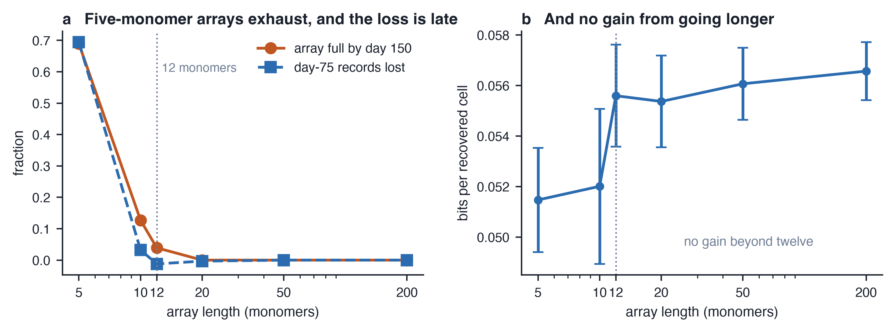
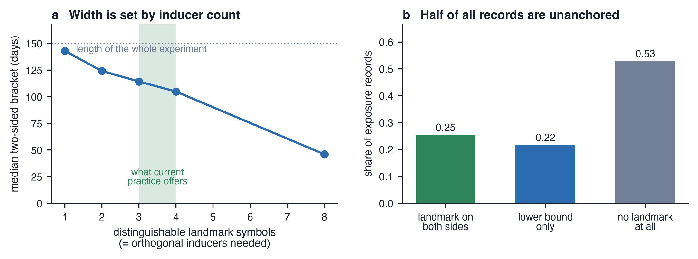

# Supplementary material

**The writable window: division-coupled DNA recorders carry a built-in early bias in human cortical organoids**

Denis Zosen

**Title:** Supplementary Material

**Description:** Supplementary Methods S1 defining every computed quantity, Tables S1 to S4 listing parameters, replication, sweep ranges and the confound, and Figures S1 and S2 on array length and temporal anchoring.

---

## Supplementary Methods S1. Quantities computed

**Write-day density.** The normalised distribution, over days, of the days on which recovered symbols were written. *f* is its mass inside the exposure windows.

**Early-to-late recording gradient.** The probability that a cell recovered on day 150 carries a record of a one-day exposure given on day 15, divided by the same probability for an exposure given on day 75. The ratio is formed within each simulated population and the ratios are then averaged, so it is a mean of ratios and differs from the ratio of the mean per-epoch probabilities by about 1.5%.

**Mark rates and information.** π is the probability that a recovered array from an exposed condition carries an exposure symbol, and φ the same for a vehicle condition run on an identical schedule with the exposure never applied, under the same random seed so the two share a population realisation. For a binary exposure with a uniform prior the mutual information is *I* = *H*(½π + ½φ) − ½*H*(π) − ½*H*(φ), with *H* the binary entropy in bits [34]; it is computed per seed and then averaged, because the map from rates to bits is not linear. The sensitivity is π, the specificity 1 − φ, the positive likelihood ratio π/φ and the predictive value at an even prior π/(π + φ).

**Closed form.** With N_w = min(n_div *q*, *L*) averaged over cells, s_on = *e*/(*c* + *e*), s_off = (*e*/*D*)/(*c* + *e*/*D*) and ε = *u*/(*A* − 1), the expected mark rates are π̂ = 1 − exp(−N_w(*f* s_on + (1 − *f*)s_off)(1 − *u*) − N_w ε) and φ̂ = 1 − exp(−N_w s_off(1 − *u*) − N_w ε). Requiring channel-derived false writes to be at most alpha times true writes gives *D* ≥ (1 − *f*)(*c* + *e*)/(*c f* alpha); setting channel-derived and miscall-derived false writes equal gives the ceiling *D* = *e*(*A* − 1)/(*c u*).

**Temporal bracketing.** For each recovered array carrying an exposure symbol, the landmark symbols before and after it define an interval. The counting rule uses the number of landmarks before the exposure symbol to identify the pulse; the conservative rule takes the earliest and latest pulses consistent with the observed sequence. Accuracy is the fraction of intervals containing the true write day, and width is the interval length in days.

**Independence of records.** Every write is assigned a unique identity that descendants inherit. Among recovered arrays carrying an exposure symbol, the number of distinct identities is the number of independent writing events, and the ratio of marked nuclei to distinct events is the pseudoreplication factor.

**Variance and power.** The between-culture variance of π is the variance of the population mark rate across independent simulated cultures, computed at a raised population cap so that subsampling does not thin the subclones it depends on. The total variance is σ²_between + π(1 − π)/*n*, so sampling noise falls below the between-culture floor at *n* = π(1 − π)/σ²_between. The contrast between two arms of *k* cultures each is a two-sample *t* on culture-level mark rates with 2(*k* − 1) degrees of freedom, because σ²_between is estimated rather than known. The standard error of the difference is √(2(σ²_between + π(1 − π)/*n*)/*k*), and the smallest detectable difference at 80% power and two-sided alpha = 0.05 comes from solving the noncentral *t* power equation for the noncentrality parameter rather than substituting quantiles. Uncertainty in σ_between propagates through the asymmetric χ² interval (*m* − 1)s²/σ².

## Table S1. Every parameter, its central value, and its status

Referred to from Methods 4.1 to 4.3 and from the Results. "Specification" means a value the experimenter chooses; "anchored" means a value taken from a published measurement; "assumption" means a value stipulated here and varied in the sensitivity analysis.

| Parameter | Central value | Status |
| --- | --- | --- |
| Duration followed | 150 days | Specification, typical organoid endpoint |
| Cell-cycle length | 30 to 110 h | Assumption, swept 22 to 140 h; lengthening over neurogenesis is well established in mammalian corticogenesis [16,17] |
| Fate probabilities | p_PP 0.30 to 0.06, p_NN 0.06 to 0.13 | Assumption, swept. Chosen so the progenitor-to-neuron trajectory is of the reported shape [12,13,15], but not fitted to those data and not compared with them quantitatively here. The cycling fraction as a time series has not been published for any organoid protocol |
| Writing rate *q* | 0.18 per array per division | Anchored to about two edits per cell division across 13 arrays in HEK293T, which is 0.15 per array per division [7]. Swept 0.02 to 0.80. Reproduces the mouse occupancy of [11] to within 30% without refitting (section 2.6). Not measured in human neural progenitors |
| Division-independent writing | 0 | Assumption, swept 0 to 0.05 per day. Dual-AAV prime editing in mouse brain implies 7 × 10⁻³ to 8 × 10⁻² per day [20]; not measured for a germline-integrated prime editor in human neurons |
| Array length *L* | 50 monomers | Specification, swept 5 to 200. Published designs use 5 [9,10], 2 to 20 [7], or 66 sites [11] |
| Exposure channel activity *e* | 6 relative to clock | Specification; enters the closed form explicitly |
| Dynamic range *D* | 1,000 | Assumption, swept 4 to 30,000. Measured ENGRAM channels are 11.5-, 19.0- and 22.6-fold [9] |
| Landmark pulses | 8, two days each, distinguishable | Specification, swept 2 to 24 pulses, 1 to 24 days, alphabet 1 to 8. The number of orthogonal inducible systems available in one long culture is the binding limit |
| Array recovery *r* | 0.60 | Anchored: 51% of organoid nuclei gave an interpretable iTracer readout [25]. Swept 0.10 to 0.80 |
| Per-symbol miscall rate *u* | 0.02 | Assumption. Sets the dynamic-range ceiling, so it is a specification rather than a nuisance parameter. Not measured for single-nucleus array amplicons |
| Symbol alphabet *A* | 10 | Follows from the design, *A* = 2 + *k*; the ceiling is linear in *A* − 1 and is checked at *A* = 3, 10 and 18 |
| Array contraction | 0.01 per monomer, excision | Assumption |
| Prime editor half-life | infinite (no silencing) | Assumption, swept 30 days to infinite. Cas9-fusion cassettes silence on differentiation of human pluripotent stem cells [28,29]; not measured for a prime editor over a 150-day neural culture |
| Per-monomer efficiency half-life | infinite (uniform) | Assumption, swept 3 monomers to infinite. Published saturation profiles show a decline along the array [7], but the in vivo decline is explained by sequential ordering alone (section 2.6) |
| Post-mitotic death | 0 | Assumption, swept 0 to 0.010 per day. Bounded above by the observed expansion |
| Intermediate progenitors | absent | Assumption, swept 0.3 to 0.8 of exiting daughters with 2 to 3 rounds, matched on expansion [27] |
| Dividing glial compartment | absent | Assumption. In the reported arms, 20% of founders switch on day 80, 100 or 120 to a dividing non-neurogenic state on a twofold longer cycle, standing in for astrocyte precursors and oligodendrocyte progenitors. A variant that cycles from *t* = 0 instead, swept 20 to 40% of founders at symmetric-proliferative probabilities of 0.06 to 0.30, is reported as a bound on the proxy rather than on the biology |
| Fate-midpoint spread between lineages | 0 days | Assumption, swept 0 to 20 days. Produces clonal heterogeneity (section 2.3) and bounds heterogeneity in fate timing (section 2.2). It is a spread over lineages, not over spatial domains. Bounded above by the observed expansion |
| Writing per day in every cell | 0 | Assumption, swept 0.005 to 0.04 per day. Decouples writing from division entirely, which is the ticker-tape regime of [23,24] and gives a gradient of 1 |
| Edit inherited by | Both daughters | Unresolved. The alternative costs 49% of the information (section 2.7) |
| Founders carrying the recorder | 1,500 | Specification, swept 150 to 6,000. Counted at the onset of neurogenesis, not at embryoid-body seeding, and set by transduction or clonal selection rather than by the culture. Sets the between-culture variance (section 2.3) |

---

## Table S2. Replication behind each reported quantity

| Quantity | Section | Replication |
| --- | --- | --- |
| Early-to-late gradient, half-capacity day, per-epoch mark rates | 2.1 | 50 populations |
| Every mechanism arm in figure 2, and the corrections over them | 2.2 | 50 populations |
| One-daughter vs both-daughters comparison | 2.7 | 50 populations |
| Mark rates, information, diagnostics | 2.4 | 6 populations |
| Full-tree lineage quantities and pseudoreplication | 2.3 | 6 populations |
| Between-culture variance and founder scaling | 2.3 | 8 cultures |
| Subsampled independence block (context only) | 2.3 | 3 populations |
| Channel requirement, readout ceiling, power, chi-squared interval | 2.3, 2.4 | closed form, no replication |
| External validation against the mouse embryo | 2.6 | closed form plus 2 × 10⁵ sampled cells |
| Glial compartment, fate-timing heterogeneity | 2.2 | 50 populations |
| Writing moved off division, the ticker-tape benchmark, the no-exit null | 2.2, 2.7 | 50 populations |
| Interaction test on the sensitivity surface | 2.7 | 4,000 bootstrap draws on the stored grid |
| Two-dimensional sensitivity surface | 2.7 | 10 populations per grid cell |
| Decomposition of the confound (Table S4) | 2.1 | closed form, no replication |

Three between-culture standard deviations appear in the released results file and they are not interchangeable. The value used throughout section 2.3 and in figures 3b and 3c comes from the founder-scaling sweep at a raised population cap: 0.014 at 150 founders, 0.012 at 300 and 0.008 at 600. A second entry, computed at the default cap of 40,000, is inflated roughly threefold by subsampling and is not used for any recommendation here. A third, the same quantity at the central 1,500 founders and a raised cap, is smaller (0.006), because the variance falls with founder number to the power −0.80.

---

## Table S3. Ranges covered by each sweep

| Parameter | Range swept |
| --- | --- |
| Writing rate *q* | 0.02 to 0.80 |
| Channel dynamic range *D* | 4 to 30,000 |
| Division-independent writing | 0 to 0.05 per day |
| Array length | 5 to 200 monomers |
| Landmark alphabet | 1 to 8 symbols |
| Landmark pulse count | 2 to 24 |
| Pulse duration | 1 to 24 days |
| Exposure separation | 3 to 49 days |
| Persistent-compartment founder fraction | 0 to 0.35 |
| Founder number | 150 to 6,000 |
| Symbol alphabet *A* | 3 to 18 |
| Editor silencing half-life | 30 days to infinite |
| Per-monomer efficiency half-life | 3 monomers to infinite |
| Post-mitotic death | 0 to 0.010 per day |
| Transit-amplifying compartments | founder fractions 0.3 to 0.8, 2 or 3 rounds, each matched on total expansion |
| Gliogenic switch day | day 80, 100 or 120, at 20% of founders |
| Always-on glial proxy | 20 to 40% of founders, symmetric-proliferative probability 0.06 to 0.30 |
| Writing per day in every cell | 0.005 to 0.04 per day, with the per-division rate set to zero |
| Fate-midpoint spread between lineages | 0 to 20 days |
| Writing rate by fate-switch midpoint, jointly | *q* 0.06 to 0.50 crossed with midpoints of 30 to 65 days, 10 populations per cell |
| Writing moved off division entirely | per-day rate 0.005 to 0.04 with the per-division rate set to zero |

---

## Table S4. What the recorder reports when a biological window is present

The recorded signal at an epoch is the true susceptibility there multiplied by
the probability that an exposure there is recorded at all. The second factor is
the writable window of section 2.1, measured as 0.0963, 0.0633, 0.0335 and
0.0185 at days 15, 35, 55 and 75. Entries are the early-to-late ratio a study
would report. Dividing the per-epoch mark rate by the per-epoch recording
probability recovers the true profile exactly in every row.

| True susceptibility, day 15 against day 75 | What the recorder reports | Reading |
| --- | --- | --- |
| flat, no biological window | 5.20-fold early | the confound alone |
| 3-fold early | 15.61-fold early | a real effect inflated fivefold |
| 3-fold late | 1.73-fold **early** | the sign is reversed |
| 5.28-fold late | 0.99 | the window is erased |

---

## Supplementary figures

**Figure S1. How array length changes what is recorded.** (**a**) Fraction of cells whose array is full at day 150, and the fraction of day-75 exposure records lost relative to an unbounded array, against array length. (**b**) Information per recovered cell against array length, mean and standard error over simulated populations. Five-monomer arrays, which current multi-channel designs use, exhaust in most cells and lose most late-epoch records; 12 monomers removes both effects, and further length adds nothing.

**Figure S2. What limits temporal anchoring.** (**a**) Median width of a two-sided bracket from the conservative landmark decoding rule, against the number of distinguishable landmark symbols, which is set by the number of orthogonal inducible systems that work in the same culture rather than by the number of pulses delivered. Width is the number of days between the earliest and latest day the exposure could have happened. (**b**) The split of exposure records by which sides carry a landmark, at eight distinguishable symbols. About half of all records carry no landmark at all, because the cell left the cycle before recording any pulse it could have used.

**Decoding rules.** Because most pulses are missed, the rule matters more than the schedule. Counting landmarks and assuming the count identifies the pulse gives brackets of median width eight days that contain the true exposure day only about a quarter of the time, and more pulses make it worse. Reading each landmark as a one-sided bound instead gives brackets containing the true day 94 to 99% of the time, at the price of width. The clock stops when the cell stops dividing, at a different time in every lineage, which is why no schedule repairs the unanchored half.
